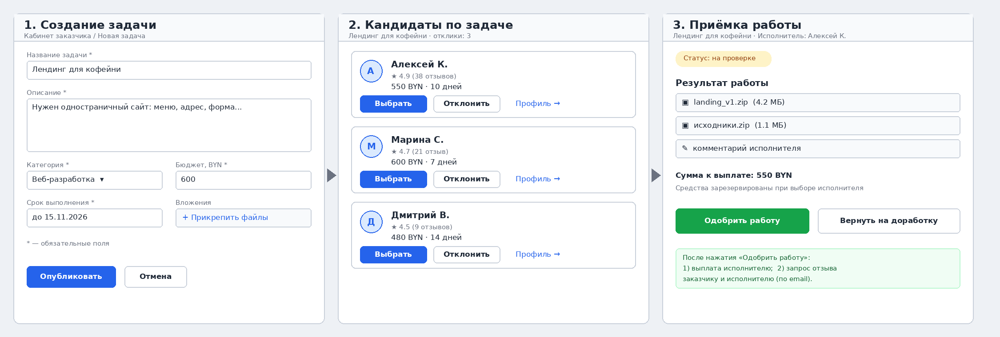

# DoneDeal — документ бизнес-требований

| Поле | Значение |
|---|---|
| Версия | 0.1 (черновик для обсуждения с Заказчиком) |
| Дата | 27.10.2026 |
| Автор (Менеджер проекта) | _ФИО, группа_ |
| Заказчик (роль) | _ФИО напарника_ |
| Дисциплина | Жизненный цикл разработки программного обеспечения |
| Статус | На согласовании (pull request) |

> Документ составлен по структуре бизнес-требований. Если заголовки в `srs/srs-template.md` отличаются, перенесите содержимое разделов в соответствующие пункты шаблона.

---

## 1. Введение

### 1.1 Назначение документа

Документ фиксирует бизнес-требования к веб-приложению **DoneDeal**: зачем оно нужно, для кого, какие цели должно достичь и что входит в первую версию. Он служит основой для дальнейшего проектирования и разработки в рамках курса.

### 1.2 Параметры проекта

| Параметр | Решение |
|---|---|
| Название | DoneDeal (рабочее название) |
| Тип | Web-приложение |
| Краткое описание | Платформа, где заказчик публикует задачу, выбирает исполнителя среди откликнувшихся кандидатов и оплачивает работу только после её приёмки |
| Язык описания | Русский |
| Язык разработки | TypeScript (предварительно) |
| Предпочтительные технологии | React (клиент), Node.js (сервер), PostgreSQL (данные) — предварительно, уточняются на этапе проектирования |
| Внешние сервисы | Платёжный шлюз (тестовый режим), сервис отправки email-уведомлений |
| Границы | Кабинет заказчика (см. раздел 4) |

### 1.3 Термины

| Термин | Определение |
|---|---|
| Заказчик | Пользователь, который публикует задачи и оплачивает работу |
| Исполнитель (кандидат) | Пользователь, откликающийся на задачу и выполняющий её |
| Задача | Описание работы с бюджетом и сроком |
| Отклик | Предложение исполнителя по задаче (цена, срок, сообщение) |
| Приёмка | Проверка результата Заказчиком и решение: одобрить или вернуть на доработку |

---

## 2. Бизнес-цели

### 2.1 Предпосылки

Небольшие заказчики (частные лица, ИП, малый бизнес) ищут исполнителей для разовых задач (сайт, дизайн, текст, небольшая разработка) через мессенджеры и соцсети. Постановка задачи, переписка с кандидатами, оплата и отзывы разнесены по разным местам. Возникают два основных риска: заказчик платит вперёд и не получает результат; исполнитель выполняет работу и не получает оплату.

### 2.2 Бизнес-возможность

Единое место, где весь цикл «задача → кандидаты → выбор → приёмка → выплата → отзыв» проходит прозрачно, а оплата привязана к решению Заказчика о приёмке работы. Это снижает риски обеих сторон и экономит время Заказчика на организацию процесса.

### 2.3 Бизнес-цели и критерии успеха

> Значения метрик предложены как ориентир и подлежат согласованию с Заказчиком.

| № | Бизнес-цель | Критерий успеха |
|---|---|---|
| BO-1 | Сократить время поиска исполнителя | Не менее 70 % задач получают выбранного исполнителя в течение 48 часов после публикации |
| BO-2 | Исключить оплату «вслепую» | Выплата происходит только после явного одобрения работы Заказчиком — в 100 % случаев |
| BO-3 | Повысить доверие к исполнителям | Отзыв оставляется не менее чем по 60 % завершённых задач |
| BO-4 | Упростить постановку задачи | Создание задачи занимает у Заказчика не более 5 минут |

### 2.4 Видение

> Для **заказчиков**, которым нужно быстро найти исполнителя и не рисковать деньгами, **DoneDeal** — веб-платформа, которая собирает постановку задачи, кандидатов, приёмку работы, выплату и отзывы в одном кабинете. В отличие от переписки в мессенджерах, **DoneDeal** связывает выплату с решением Заказчика о приёмке работы.

---

## 3. Заинтересованные стороны

| Сторона | Интересы / ожидания |
|---|---|
| Заказчик | Быстро поставить задачу, сравнить кандидатов, не платить за невыполненную работу, иметь историю задач и отзывов |
| Исполнитель | Понятное описание задачи, гарантия оплаты при принятой работе, возможность получить отзыв |
| Администратор платформы | Контроль качества контента, поддержка пользователей, доступ к статистике |
| Платёжный сервис (внешний) | Корректные и безопасные запросы на резервирование и выплату средств |
| Преподаватель (бизнес-сообщество) | Соответствие документа заданию, обоснованность решений |

---

## 4. Границы проекта

### 4.1 Включено в первую версию (MVP)

Кабинет заказчика:

1. Регистрация и вход.
2. **Форма создания задачи**: название, описание, категория, бюджет, срок, вложения.
3. **Список кандидатов** по задаче: имя, рейтинг, предложенные цена и срок, действия «Выбрать» / «Отклонить».
4. Страница задачи со статусом (опубликована → исполнитель выбран → на проверке → завершена).
5. Кнопка **«Одобрить работу»**: инициирует выплату исполнителю и отправляет запрос отзыва.
6. Кнопка «Вернуть на доработку».
7. Email-уведомления о ключевых событиях (новый отклик, работа сдана, выплата выполнена, запрос отзыва).

### 4.2 Не включено в первую версию

- Мобильное приложение.
- Реальные денежные операции (используется тестовый режим платёжного шлюза).
- Чат между Заказчиком и Исполнителем.
- Арбитраж спорных ситуаций.
- Полноценный кабинет исполнителя (отклики на этапе MVP поступают из упрощённой формы или тестовых данных; см. открытый вопрос Q-1).

### 4.3 Ограничения и допущения

| № | Описание |
|---|---|
| C-1 | Срок разработки ограничен учебным семестром |
| C-2 | Разработку ведёт один студент |
| C-3 | Платежи только в тестовом режиме |
| A-1 | Исполнители и заказчики регистрируются по email |
| A-2 | Стоимость и срок задачи указывает Заказчик при создании |

### 4.4 Риски

| № | Риск | Вероятность | Влияние | Меры |
|---|---|---|---|---|
| R-1 | Требования изменятся в ходе разработки | Высокая | Среднее | Работа через ветки и pull request, фиксация изменений, приоритизация |
| R-2 | Недоступность или ограничения платёжного шлюза | Средняя | Высокое | Использовать тестовый режим, изолировать интеграцию отдельным модулем |
| R-3 | Недостаточно времени на весь функционал | Средняя | Среднее | Реализовать MVP, остальное отложить |

---

## 5. Бизнес-процессы верхнего уровня

### 5.1 Постановка задачи

1. Заказчик открывает форму создания задачи.
2. Заполняет обязательные поля и прикладывает файлы.
3. Нажимает «Опубликовать» — задача становится доступной исполнителям.

### 5.2 Выбор исполнителя

1. Заказчик открывает список кандидатов по задаче.
2. Просматривает рейтинг, цену, срок и сообщение каждого кандидата.
3. Нажимает «Выбрать» у подходящего кандидата; остальным отклики можно отклонить.
4. Сумма резервируется (см. бизнес-правило BR-2).

### 5.3 Приёмка работы и выплата (основной сценарий)

1. Исполнитель сдаёт работу — задача получает статус «на проверке».
2. Заказчик просматривает результат.
3. Нажимает **«Одобрить работу»**.
4. Система выполняет выплату исполнителю.
5. Система отправляет запрос отзыва Заказчику и Исполнителю.

Альтернативный сценарий: Заказчик нажимает «Вернуть на доработку» — задача возвращается исполнителю со статусом «на доработке», выплата не выполняется.

---

## 6. Бизнес-правила

| № | Правило |
|---|---|
| BR-1 | Выплата исполнителю выполняется только после нажатия Заказчиком кнопки «Одобрить работу» |
| BR-2 | При выборе исполнителя сумма бюджета резервируется до приёмки работы |
| BR-3 | Запрос отзыва отправляется автоматически после выплаты |
| BR-4 | Отзыв может оставить только участник завершённой задачи |
| BR-5 | Одобрение работы необратимо |

---

## 7. Прототип интерфейса (GUI)

Экраны кабинета заказчика: создание задачи, список кандидатов, приёмка работы.



### 7.1 Модель структуры интерфейса (SysML v2, текстовая нотация)

```sysml
package DoneDealCustomerCabinet {

    part def TaskCreationForm {
        attribute title : String;
        attribute description : String;
        attribute category : String;
        attribute budget : Real;
        attribute deadline : String;
        action publish;
        action cancel;
    }

    part def CandidateCard {
        attribute name : String;
        attribute rating : Real;
        attribute price : Real;
        attribute durationDays : Integer;
        action select;
        action reject;
    }

    part def CandidatesList {
        part cards : CandidateCard[0..*];
    }

    part def WorkAcceptanceScreen {
        attribute status : String;
        attribute payoutAmount : Real;
        action approveWork;   // выплата + запрос отзыва
        action returnForRevision;
    }

    part def CustomerCabinet {
        part taskForm : TaskCreationForm;
        part candidates : CandidatesList;
        part acceptance : WorkAcceptanceScreen;
    }
}
```

---

## 8. Открытые вопросы к Заказчику

| № | Вопрос |
|---|---|
| Q-1 | Нужен ли в первой версии кабинет исполнителя или достаточно упрощённой формы отклика? |
| Q-2 | Резервировать ли средства при выборе исполнителя (BR-2) или списывать только при приёмке? |
| Q-3 | Нужна ли комиссия платформы и как она рассчитывается? |
| Q-4 | Сколько раз можно возвращать работу на доработку? |

---

## 9. Журнал замечаний (pull request)

| № | Источник | Замечание | Решение (принято / отклонено) | Обоснование |
|---|---|---|---|---|
| 1 | Напарник | | | |
| 2 | Напарник | | | |
| 3 | Преподаватель | | | |
